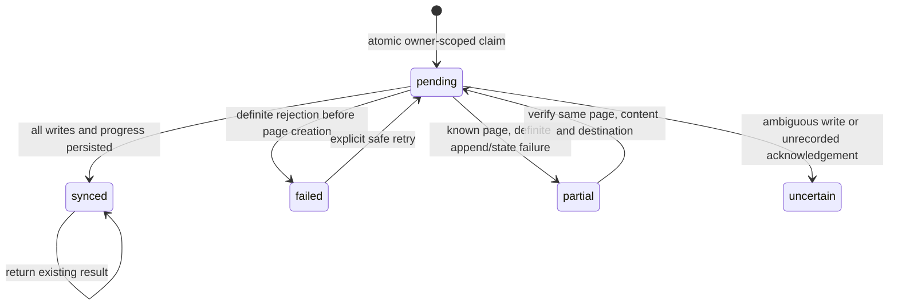

# Notion content saving

> Updated saving behavior: see [Explicit content destinations](explicit-content-destinations.md). That phase supersedes historical automatic-sync and frontend-availability statements below.
Implemented backend scope: authenticated destination discovery, explicit default selection, internal credential access, content export, safe retry, and optional post-creation synchronization. The existing extension is unchanged and does not yet expose these endpoints.

## Architecture

MongoDB remains the primary store. Existing content creation still validates input, runs AI enrichment, commits the content transaction, and returns `{ status: "success", data: { content, ai } }`. After commit, Notion runs independently as best-effort background work. The existing TickTick operation is still awaited and attempted independently. A Notion success is **not** added to or implied by the primary content response.

| File | Responsibility |
| --- | --- |
| `services/notionCredentials.js` | Existing authoritative atomic refresh, plus internal owner-scoped access-token snapshots and conditional rejection marking |
| `utils/notionApi.js` | Fixed-host, versioned, bounded requests and one controlled 401 refresh/retry |
| `validators/notionValidator.js` | Strict destination, search/cursor and content-ID validation |
| `utils/notionErrors.js` | Stable public error codes, fixed safe messages and HTTP status mapping |
| `services/notionDestinationService.js` | Search normalization, live destination/schema verification and selection persistence |
| `utils/notionContentBlocks.js` | Content mapping, Unicode-safe chunks, size checks and block batching |
| `services/notionContentService.js` | Owned-content loading, synchronization claims, create/append progress and safe retries |
| `Models/Content.js` | Optional `integrations.notion` subdocument; existing integration fields/indexes preserved |
| `services/postContentCreationService.js` | Independent optional Notion work after the primary commit |
| `Routes/notionContentRoute.js` | Authenticated endpoint contracts and controlled, non-cacheable responses |
| `index.js` | Additive mount beside the existing Notion link/status router |
| `swagger/UI/notion-content.docs.js` | New endpoint request/response OpenAPI definitions |
| `swagger/UI/swagger-ui.js` | Mount the Notion definitions and declare application JWT authentication |
| `swagger/UI/content.docs.js` | Clarify primary-save success versus independent Notion delivery |
| `tests/notionContent.test.js` | Credential, HTTP, destination, content, concurrency and endpoint regressions |
| `tests/helpers/notionContentFixture.js` | Test-only encrypted credentials and mocked HTTP/model operations |
| `tests/contentSaving.test.js` | Real existing content pipeline tests including Notion isolation, response shape and mocked AI enrichment |
| `tests/notionContent.integration.test.js` | Optional disposable MongoDB claim/ownership/index verification |
| `docs/notion-content-saving.md` | Architecture, contracts, security, lifecycle, validation and limitations |
| `docs/notion-linking.md` | Cross-reference the implemented content phase while retaining the OAuth contract |

No dependencies, production environment files, credentials, deployment settings, Google/JWT flows, OAuth callbacks, encryption algorithms or TickTick synchronization contracts were changed. `ConnectedAccount` needs no schema/index change because its existing metadata supports a selected destination.

## API-version compatibility

All Notion calls use the existing, fail-closed `NOTION_API_VERSION=2026-03-11` configuration. There is no host override. Schemas were checked against the official references:

- [Search](https://developers.notion.com/reference/post-search): discover pages and data sources accessible to the connection. One request returns at most 50 requested results; there is no unbounded pagination loop.
- [Database objects](https://developers.notion.com/reference/database) and [data-source retrieval](https://developers.notion.com/reference/retrieve-a-data-source): modern databases contain data sources. A database ID can be selected as an alias only when a live retrieval returns exactly one source and the retrieved source confirms that database parent. Multiple sources require explicit data-source selection. A legacy object without that mapping is rejected, never guessed.
- [Create page](https://developers.notion.com/reference/post-page): page parents use `page_id` and the page `title` property; data-source parents use `data_source_id` and the actual retrieved title-property ID. No fixed `Name` column is assumed.
- [2026-03-11 upgrade guide](https://developers.notion.com/guides/get-started/upgrade-guide-2026-03-11) and [append children](https://developers.notion.com/reference/patch-block-children): use `in_trash` and the current `position: { type: "end" }` shape, not the old `after` parameter. Trashed/archived resources are excluded or rejected.
- [Request limits](https://developers.notion.com/reference/request-limits): rich-text strings stay within 2,000 UTF-16 code units, block batches within 100 children, and serialized requests within a conservative 480,000-byte budget below the documented 500KB limit. No write is automatically retried for 5xx/transport errors, which can conceal a committed operation.

Workspace-root page creation, views, linked-database aliases without a verifiable source, file/image upload, database/schema creation and arbitrary property mapping are not supported. Discovery establishes visibility, not guaranteed insertion capability; Notion enforces write permission at creation.

## Authentication and credentials

Every new endpoint uses the unchanged `requireAuth` JWT middleware. The owner comes exclusively from `req.user.userId`. Content lookup uses `{ _id: contentId, userId }`; another user's record and a nonexistent record both produce the same 404. Automatic work derives its owner from the committed content record and re-loads that owner's content.

The internal credential reader requires an existing `User`, its Google `AuthIdentity`, and a connected Notion account queried by `{ userId, provider: "notion" }`. It checks the verified workspace/user composite identity and reconnect/refresh-claim state. Only the access ciphertext required for requests is explicitly selected; refresh ciphertext remains inside the existing refresh implementation. Access decryption uses the existing AES-GCM helper with `{ userId, provider: "notion", tokenType: "access" }`.

Internal snapshots contain plaintext access credentials and an access-ciphertext CAS version. **They must never be serialized, logged, sent to a client, or stored in Content.** Endpoints whitelist their result fields. Errors have fixed messages and never forward raw provider errors, request headers, stack traces or credential envelopes.

The API client accepts only a small method/path allowlist under `https://api.notion.com/v1`. It sends Authorization, Notion-Version, Accept and JSON Content-Type where applicable, prohibits redirects, limits decoded responses to 2 MiB and applies a 10-second timeout. Multi-batch work has a 60-second provider-request budget; database operations and the existing refresh operation use their existing timeout behavior.

There is no invented token-expiry date or periodic refresh. On a real 401:

1. Re-read the owner-scoped access snapshot. If another operation already rotated it, reuse that persisted token instead of rotating again.
2. Otherwise invoke the existing `refreshForUser()` and its atomic, non-expiring refresh claim.
3. Re-read persisted access credentials and retry the original operation once, retaining its connection/selection binding.
4. A second 401 conditionally marks only that rejected credential version disconnected/reconnect-required. It cannot disconnect a newer reconnect. Refresh failure returns a controlled error; a held claim returns `NOTION_REFRESH_UNAVAILABLE` without polling.

A 403 never triggers a refresh. Rate limits and overload are surfaced with a validated Retry-After header when supplied; there is no automatic rate-limit retry loop. The existing refresh implementation remains authoritative and unchanged in its rotation, claim, supersession and uncertain-outcome behavior.

## Selection persistence

Selection always performs live resource retrieval, verifies the object/ID and trash state, and requires exactly one usable title property for a data source. Client titles, workspace IDs and URLs are not accepted as access evidence. No selection operation creates a page.

Only this small optional pointer is stored on the owner's existing account:

```json
{
  "metadata": {
    "notionDestination": {
      "id": "aaaaaaaa-aaaa-aaaa-aaaa-aaaaaaaaaaaa",
      "type": "page",
      "selectionId": "eeeeeeee-eeee-eeee-eeee-eeeeeeeeeeee"
    }
  }
}
```

The selection revision is generated by the server. Dot-path writes preserve unrelated metadata, ciphertexts, verified identity and all existing indexes. Persistence compares the access-ciphertext version used to validate access; a concurrent reconnect/rotation can cause a controlled 409 rather than accept stale proof. Normal 401 refresh within validation returns its fresh snapshot and can complete selection normally.

The existing OAuth reconnect replaces metadata, deliberately clearing the old selection. Refresh updates only its existing metadata fields and retains the selection. Each export revalidates the selected destination/schema; changing the selection or connection during an export is detected before subsequent dispatches. A provider write already in flight cannot be undone by a concurrent reconnect; its outcome remains tied to the snapshot recorded on the content.

## Content mapping and bounds

- Use the saved `title` as the page title, with `Saved knowledge` as a fallback for legacy missing titles.
- Export `rawText` as readable paragraph blocks. Normalize CRLF, preserve single line breaks, and split long paragraphs without splitting UTF-16 surrogate pairs.
- Include the original HTTP(S) source URL as a linked source paragraph when present. Credential-bearing, non-HTTP(S), malformed or overlong URLs are rejected before creation.
- Include existing tags as text. No destination-specific multi-select options are invented.
- Include the existing summary under a Summary heading. If `mergeSummaryWithContent` already appended the exact summary suffix to rawText, do not append it again.
- Populate only the required real title property. Optional fields stay in blocks, avoiding guesses about arbitrary destination schemas.
- Reject malformed text, titles over 500 code units, more than 1,000 tags, combined mapped source text over 400,000 code units, or more than 1,000 generated blocks. These are deliberate application bounds, not claims about a page's total Notion capacity. No content is silently truncated to fit.
- Create with the first byte/count-bounded block batch. Append remaining batches sequentially using the same service and existing page ID.

Only confirmed provider page IDs and safe actual Notion URLs are saved. A successful response missing either is treated as uncertain; no URL is synthesized. A safe `committed_resource_id` from a failed provider response can be retained for reconciliation without reporting success.

## Synchronization lifecycle and duplicate prevention

`integrations.notion` is optional, so existing content documents and their response shapes do not gain empty state automatically. It contains status, hidden claim, phase, actual page ID/URL, destination/connection binding, content hash, confirmed block progress, total blocks, last-attempt time and a safe error code. It contains no provider credentials.



The database claim requires the owner's content, no existing claim, no pending/synced/uncertain status, and the expected existing page ID. Every progress/finalization write compares that exact claim and pending status. It never uses the whole content timestamp as a lock: parallel TickTick metadata updates are expected and must remain independent.

- **Synced:** return the existing ID/URL with `alreadySynced: true`; do not create a second page. The current connection and a selected destination must still be usable. Changing the default does not re-export already synchronized content into a new destination.
- **Failed:** a definite rejection before a page existed can be explicitly retried using the current verified selection.
- **Partial:** retain the real page and confirmed block count. Retry verifies the original content hash, destination and connection identity, retrieves the existing page and checks its parent, then appends only remaining blocks. A changed body/destination produces `NOTION_SYNC_CONFLICT`.
- **Uncertain:** retain the claim and any known page ID/URL. Do not create or append again automatically. This includes write timeouts, 5xx uncertainty, malformed successful write responses, and successful writes whose acknowledgements could not be persisted.
- **Pending after a crash/outage:** the claim has no automatic lease expiry. A later request returns `NOTION_SYNC_IN_PROGRESS`; it does not assume that the provider did nothing.

There is **no exactly-once guarantee** across Notion and MongoDB. If Notion commits and MongoDB cannot record it, the durable claim prevents blind duplicate creation. Reconciliation requires an operator to inspect the correct Notion workspace/page and persisted phase/progress, establish the exact provider result, and then repair state through a separately reviewed administrative process. No force-reset endpoint, automatic claim stealing, destructive page rollback or guessed reconciliation is implemented.

## Endpoint contracts

All paths below start with `/api/v1/integrations/notion`. Send the existing application JWT in `Authorization: Bearer APP_JWT`. All new responses set no-store/no-cache/no-referrer headers. UUIDs may be hyphenated or compact; responses use canonical lowercase hyphenated UUIDs. Unknown selection/search fields and nonempty sync/clear bodies are rejected.

### Discover

`GET /destinations?query=reading&cursor=77777777-7777-7777-7777-777777777777`

Both parameters are optional. Query is at most 200 code units; cursor must be a Notion UUID cursor. Search is title search, not full-text search. Results contain untrusted display text, which a future frontend must render as text rather than HTML.

```json
{
  "status": "success",
  "data": {
    "destinations": [{
      "id": "aaaaaaaa-aaaa-aaaa-aaaa-aaaaaaaaaaaa",
      "type": "page",
      "title": "Reading",
      "url": "https://www.notion.so/aaaaaaaaaaaaaaaaaaaaaaaaaaaaaaaa",
      "lastEditedTime": null
    }],
    "hasMore": false,
    "nextCursor": null
  }
}
```

Missing/unexpected title fragments become `Untitled page` or `Untitled data source`; unavailable URLs/timestamps become null. Only page/data-source objects are returned. Pagination is never automatically followed or used to choose a default.

### Select, read or clear

`PUT /destination`, JSON body:

```json
{ "destinationId": "aaaaaaaa-aaaa-aaaa-aaaa-aaaaaaaaaaaa", "destinationType": "page" }
```

`destinationType` accepts `page`, `data_source`, or the single-source `database` alias. A successful PUT returns `{ "status": "success", "data": { "destination": DESTINATION } }`, where DESTINATION has the same safe display shape as a discovery result. A database alias returns its canonical data source.

`GET /destination` returns the stored pointer, not cached provider metadata:

```json
{ "status": "success", "data": { "destination": { "id": "aaaaaaaa-aaaa-aaaa-aaaa-aaaaaaaaaaaa", "type": "page" } } }
```

`DELETE /destination`, with no body, clears the default and returns:

```json
{ "status": "success", "data": { "destination": null } }
```

GET also returns a null destination when a usable connection has no selection. Clearing a default does not delete previously exported pages or alter their recorded results.

### Synchronize or safely retry existing content

`POST /sync/aaaaaaaaaaaaaaaaaaaaaaaa`, with no body. The ID is the existing MongoDB Content `_id`, not a user ID or Notion ID.

```json
{
  "status": "success",
  "data": {
    "status": "synced",
    "pageId": "99999999-9999-9999-9999-999999999999",
    "pageUrl": "https://www.notion.so/provider-confirmed-page-99999999999999999999999999999999",
    "alreadySynced": false
  }
}
```

The URL shown is illustrative; implementation always uses the actual provider response. A repeated successful operation returns the same recorded ID/URL with `alreadySynced: true`. Failure never deletes the primary content record.

## Errors

New service errors use `{ "status": "error", "code": "SAFE_CODE", "message": "Fixed safe message" }`. The unchanged JWT middleware retains its existing 401 response shape. Neither success nor error responses contain access/refresh tokens, ciphertext, raw provider responses or stacks.

| HTTP | Codes / meaning |
| --- | --- |
| 400 | `INVALID_NOTION_INPUT`: malformed IDs, cursors, body or unexpected parameters |
| 401 | Existing JWT middleware: missing, invalid, expired token or missing application user |
| 403 | `GOOGLE_IDENTITY_REQUIRED`, `NOTION_PERMISSION_DENIED` |
| 404 | `NOTION_CONTENT_NOT_FOUND` (also cross-owner content), `NOTION_RESOURCE_NOT_FOUND` |
| 409 | `NOTION_NOT_CONNECTED`, `NOTION_RECONNECT_REQUIRED`, `NOTION_REFRESH_UNAVAILABLE`, `NOTION_CONNECTION_CHANGED`, `NOTION_DESTINATION_REQUIRED`, `NOTION_SYNC_IN_PROGRESS`, `NOTION_SYNC_UNCERTAIN`, `NOTION_SYNC_CONFLICT` |
| 422 | `NOTION_DESTINATION_UNSUPPORTED`, `NOTION_DESTINATION_INVALID`, `NOTION_SCHEMA_INVALID`, `NOTION_DATABASE_AMBIGUOUS`, `NOTION_INVALID_REQUEST`, `NOTION_INVALID_CONTENT`, `NOTION_CONTENT_LIMIT` |
| 429 | `NOTION_RATE_LIMITED`; validated Retry-After header when provided |
| 502 | `NOTION_INVALID_RESPONSE` for malformed read responses; ambiguous write responses instead quarantine synchronization |
| 503 | `NOTION_PROVIDER_UNAVAILABLE`, `NOTION_PERSISTENCE_FAILED`, `NOTION_LINK_UNAVAILABLE`, `TOKEN_ENCRYPTION_UNAVAILABLE` |
| 500 | `NOTION_SYNC_FAILED`: sanitized unexpected service failure |

Once a write becomes ambiguous, `NOTION_SYNC_UNCERTAIN` takes precedence over the underlying provider error; the safe underlying error category remains in the content state. A total database outage can prevent that state update, leaving the prior durable pending claim as the safety mechanism.

## Tests and validation

Routine tests use mocked HTTP/model operations and test-only encryption/JWT values. They never load `.env`, require real Notion credentials or write to Notion.

```powershell
node --test tests/notionLinking.test.js tests/notionContent.test.js
node --test tests/contentSaving.test.js
npm test
git diff --check
```

The optional MongoDB test reuses the existing explicit `NOTION_LINK_TEST_MONGODB_URI`, which must point to a disposable test server. It forces a random `notion_content_test_<random>` database, creates the existing declared indexes there, tests the real service's competing claims/metadata isolation, and drops only that generated test database. It never uses `DATABASE` or production `.env`. Without the explicit URI it is skipped, not passed.

Validation on 2026-10-27:

- Focused linking/content tests: **130 passed, 0 failed, 0 skipped**.
- Existing content-saving pipeline tests including the new isolation/AI cases: **29 passed, 0 failed, 0 skipped**.
- Complete suite: **332 tests, 329 passed, 0 failed, 3 skipped**. All three skips are opt-in disposable MongoDB tests (the existing TickTick and Notion linking tests, and the new Notion content test).
- `node --check` passed for all 18 changed/new JavaScript files; `git diff --check` passed. All 23 frontend files matched their SHA-256 baseline from the beginning of this backend task. No frontend build/lint/type-check scripts are defined.
- Live authorization/provider writes and real MongoDB claim arbitration were not exercised in this environment.

## External prerequisites and next milestone

Use the existing configured public Notion connection, encryption keys and `2026-03-11` version. The connection needs appropriate Read Content and Insert Content capabilities, and users must share the intended parent page/database with it. The user must explicitly select a destination through this API after linking/reconnecting. No new production environment variable, credential rotation, database migration or index removal is required.

Post-creation work is intentionally in-process best effort, not a durable queue. A process exit before claiming can lose an automatic attempt; the explicit endpoint can start it later. A process exit after claiming requires reconciliation. Manual edits to an exported Notion page are not tracked, and partial retries cannot detect arbitrary human edits to existing block contents. No update-in-place, bidirectional sync, reconciliation UI or automatic repair is claimed.

The next backend milestone is a durable job/outbox worker with operational status, bounded rate-aware retries for definite failures, and an explicit reconciliation workflow for uncertain/pending operations. Frontend destination controls remain a separate task.
